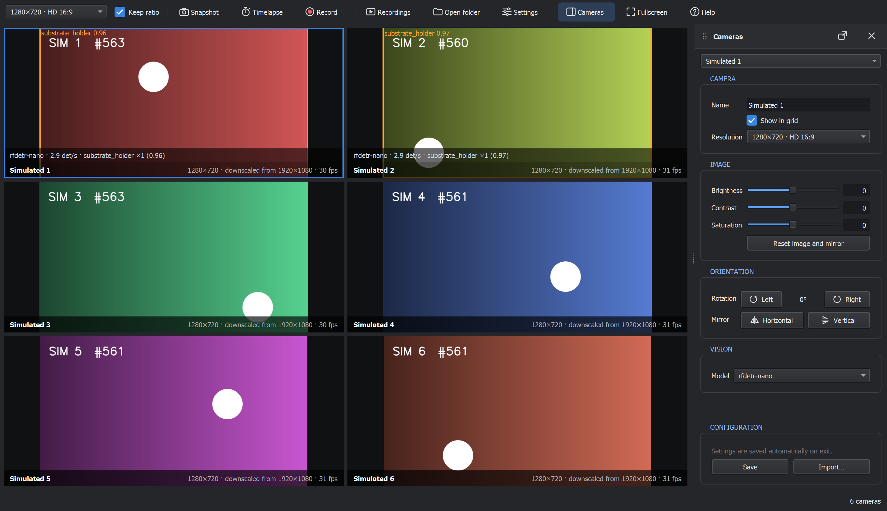
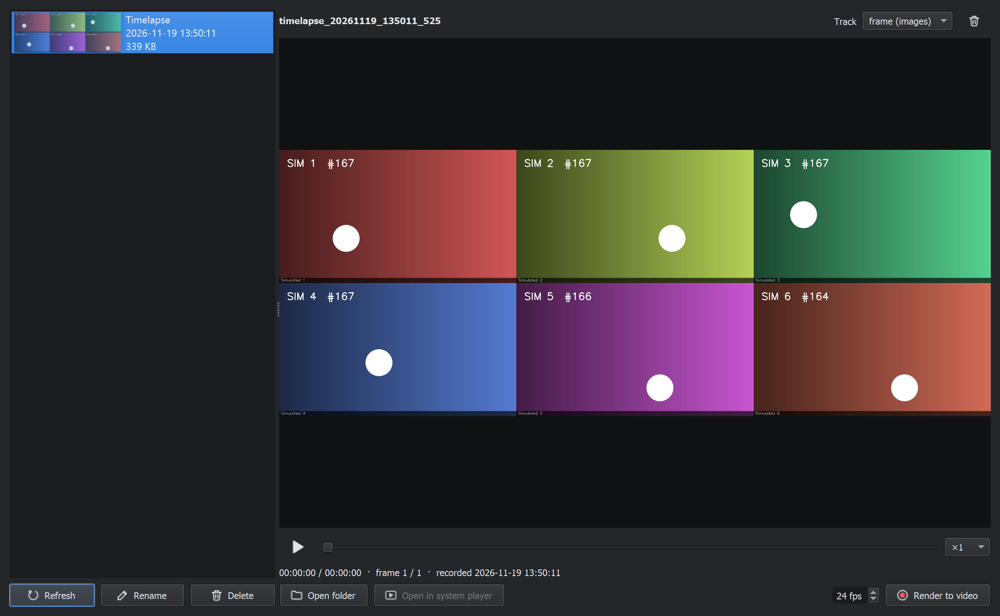
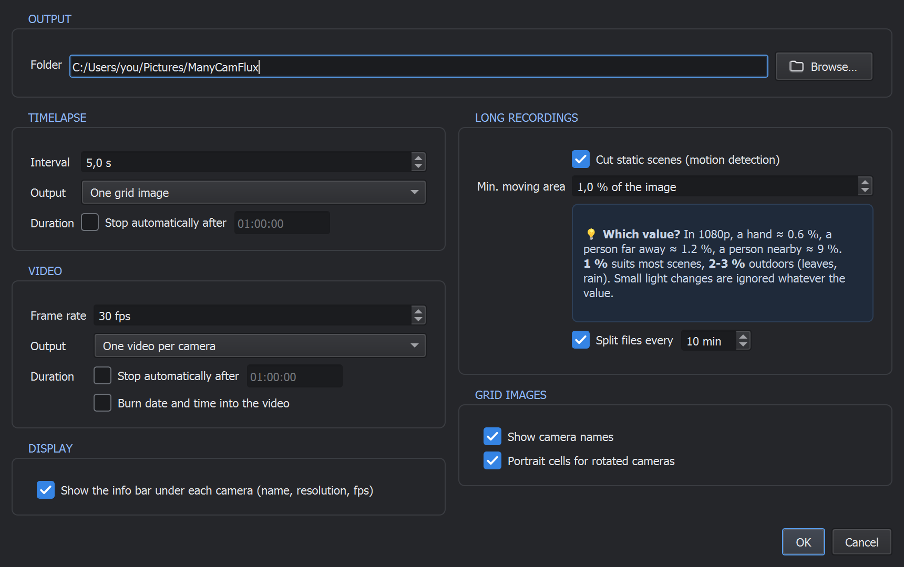

[](https://wakatime.com/badge/user/a16f794f-b91d-4818-8dfc-d768ce605ece/project/94551038-ee66-499c-98e7-57493dd05c2d)

ManyCamFlux is a tiny project designed to manage multiple webcam feeds. It provides a simple interface to view, control, and capture screenshots from multiple cameras simultaneously.

> [!IMPORTANT]
> **🎉 ManyCamFlux 2.0 is out!** Almost everything was rewritten: threaded capture, hot-swap, video recording, timelapse, recordings browser, new camera panel...
>
> 👉 See the full patch note in the [**2.0 release**](https://github.com/MatisAgr/ManyCamFlux/releases/tag/2.0).
>
> Looking for the previous version? It is archived in the [Version-1.2-(OLD)](https://github.com/MatisAgr/ManyCamFlux/tree/Version-1.2-(OLD)) branch.







*Screenshots taken with simulated cameras (`--simulate 6`).*

## Features

- **Hot-swap**: plug or unplug cameras while the app runs; they appear or disappear automatically, and each camera gets its settings back when it is plugged in again.
- **Smooth live view**: each camera is captured in its own thread (MJPG when supported, so HD runs at full frame rate). The grid adapts to the window size and camera ratio.
- **Camera panel**: name, visibility, resolution, brightness, contrast, saturation, rotation and horizontal/vertical mirror per camera, all applied live. Drag its title bar to detach it, or close it (`Ctrl+B`).
- **Resolution per camera**: the toolbar sets every camera at once, the panel sets one. Only resolutions up to each camera's native one are offered (detected automatically). The info bar under each view says whether the camera runs at its **native** (largest) resolution or is **downscaled** (and from what). The info bar can be hidden in *Settings*.
- **Snapshots**: one grid image of all cameras (`S`), or a single camera (right-click).
- **Timelapse** (`T`): images at a regular interval (one grid image or one image per camera).
- **Video recording** (`R`): one video per camera or one grid video, at the frame rate you choose.
- **Timed recordings**: a video or a timelapse can stop by itself after a duration (`hh:mm:ss`, more than 24 h allowed), set in *Settings*; the status bar shows the time left.
- **Long recordings (24 h and more)**: videos are split into parts (every 10 min by default), so a crash or power cut only loses the part being written; recording stops by itself before the disk is full (< 1 GB free). Splitting can be turned off (one file per camera), with a warning: an interrupted single file is lost.
- **Cut static scenes**: optional motion detection only keeps the frames where something moves (plus 2 s after), so a 24 h recording of a mostly still scene stays short. The date and time can be burned into the video.
- **Recordings browser** (`Ctrl+L`): every session with a thumbnail, a built-in player (all parts as one timeline, speed up to ×64, frame by frame with ←/→) showing the real capture time of each frame, and *Render to video* for timelapses, with a progress bar at the bottom of the window. Recordings can be renamed (`F2`) and deleted (`Del`, to the recycle bin), or just one camera's track.
- **Frame tracking**: each timelapse/video session has a `frames.csv` with the frame number, timestamp, elapsed time and the source frame number of each camera (useful to spot dropped or duplicated frames).
- **Focus & fullscreen**: double-click a camera to show it alone, `F11` for fullscreen, `Esc` to go back.
- **Persistent settings**: saved automatically on exit (`~/Documents/ManyCamFlux/`), importable from a file.

## Download (Windows)

Two versions are available in the [latest release](https://github.com/MatisAgr/ManyCamFlux/releases/latest), nothing to install:

| File | How to use it | Startup |
|------|---------------|---------|
| `ManyCamFlux_2.0_windows.zip` (**recommended**) | Unzip it, then run `ManyCamFlux.exe` inside the folder. Keep the `_internal` folder next to the `.exe`. | Fast |
| `ManyCamFlux_2.0_portable.exe` | A single file: just run it. | Slower (it unpacks itself on every launch) |

## Requirements

To run ManyCamFlux, you need the following Python packages:

```plaintext
PyQt5
opencv-python
numpy
```

You can install these packages using the following command:

```sh
pip install -r requirements.txt
```

## Usage

1. **Clone the repository**:
    ```sh
    git clone https://github.com/MatisAgr/ManyCamFlux.git
    cd ManyCamFlux
    ```

2. **Run the application**:
    ```sh
    python ManyCamFlux.py
    ```

3. **Pick the resolution** in the toolbar (each camera uses the closest one it supports, shown at the bottom of its view).

4. **Adjust cameras** in the *Cameras* panel (`Ctrl+B` to show/hide it). Click a camera view to select it.

5. **Capture**: *Snapshot*, *Timelapse* and *Record* in the toolbar. Interval, frame rate, output mode and folder are in *Settings* (`Ctrl+,`).

### Shortcuts

| Key | Action |
|-----|--------|
| `S` | Snapshot of all cameras |
| `T` | Start/stop timelapse |
| `R` | Start/stop video recording |
| `Ctrl+L` | Recordings browser |
| `F1` | Help: version and shortcuts |
| `Ctrl+O` | Open the output folder |
| `Ctrl+B` | Show/hide the Cameras panel |
| `F11` | Fullscreen |
| `Esc` | Leave focus / fullscreen |

## Notes

- Output goes to `~/Pictures/ManyCamFlux/` (`snapshots/`, `timelapse_<date>/`, `video_<date>/`). Keep the output folder path ASCII-only for videos (OpenCV limitation on Windows).
- Configuration is stored in `~/Documents/ManyCamFlux/`. Configs from older versions are still read.
- Tests: `python -m pytest -q tests`
- **No camera at hand?** `python ManyCamFlux.py --simulate 6` adds 6 simulated 30 fps cameras (moving target + frame number), handy to test the grid, recordings and frames.csv.

## Build with PyInstaller

To build your modifications of ManyCamFlux project into a standalone executable using PyInstaller, follow these steps:

1. **Install PyInstaller**:
    ```sh
    pip install pyinstaller
    ```

2. **Compile the project**:
    ```sh
    pyinstaller -D -w --add-data="assets;assets" -i assets/icon.ico ManyCamFlux.py
    ```
    - **Single file**: use `-F` instead of `-D` (simpler to share, but slower to start: it unpacks itself on every launch)
    - **Enable debug console**: Remove `-w`
        - **Exclude icon**: Remove `-i assets/icon.ico`
    - **For Mac/Linux**: Replace `;` with `:` in `--add-data="assets/*:."`

📌 More details available at: [PyInstaller Documentation](https://pyinstaller.org/en/stable/usage.html)


3. **Run the executable**:
    - After the compilation, the executable is in `dist/ManyCamFlux/ManyCamFlux.exe`. You can run it directly from there.
    - With `-D`, the `.exe` needs the `_internal` folder next to it: share the whole `dist/ManyCamFlux` folder (zipped). With `-F`, the `.exe` alone is enough (`dist/ManyCamFlux.exe`).

**Note:**

If PyInstaller is not recognized after installation, try this command:
```sh
python -m PyInstaller -D -w --add-data="assets;assets" -i assets/icon.ico ManyCamFlux.py
```

*Further updates and adjustments will follow.*
